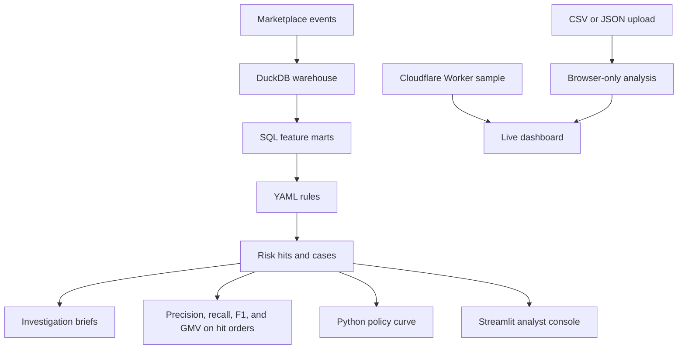

# Marketplace Risk Intelligence

**Fraud monitoring, investigation, and enforcement-policy simulation for a social-commerce marketplace, built on synthetic data with transparent SQL rules.**

[](https://tiktok-shop-risk-intelligence.madanmohanlearning.workers.dev/)
[](https://github.com/MadanMohan0537/marketplace-risk-intelligence/actions/workflows/ci.yml)


🌐 **[Open the live risk dashboard](https://tiktok-shop-risk-intelligence.madanmohanlearning.workers.dev/)**

> Independent portfolio project, modeled on a TikTok Shop–style marketplace. It is **not affiliated with or endorsed by TikTok or ByteDance**, and it uses **no real seller, order, or enforcement data**. All bundled data is synthetic. (Previously named `TikTok-Shop-Risk-Intelligence`.)

---

## The problem

Marketplace risk teams must catch refund abuse, fake orders, promotion abuse, account takeover, and seller collusion **without** blocking so many legitimate buyers and sellers that the user experience suffers. Black-box scores make that trade-off hard to explain to policy, operations, and product partners.

## Who it is for

The project is shaped around the day-to-day work of an e-commerce **risk control / anti-fraud analyst** and the product and operations partners who set enforcement policy.

## Approach

- **Explainable rules instead of one opaque score.** Each SQL rule in `configs/rules.yaml` names its fraud typology, entity (buyer, seller, creator, or order), severity, recommended action, weight, rationale, and the evidence it returns to an investigator.
- **Investigation-first output.** In the Python pipeline, rule hits become prioritized cases with evidence packets and analyst briefs.
- **Policy as a product decision.** On the live dashboard, moving the threshold changes how many cases are sent to enforcement and how much value is reviewed. `shop-risk policy` reports enforced count, precision, recall, and F1 at each score cut against the synthetic labels.
- **Each typology has a user-experience guardrail** in `configs/fraud_typology.yaml`. Account takeover defaults to step-up authentication. Other defaults include refund holds, coupon bans, review takedowns, payment blocks, and network holds. Repeat hits can escalate through `configs/enforcement.yaml`.

## Metrics the project tracks

These are demonstration results on synthetic data.

- **Python CLI:** `shop-risk evaluate` prints precision, recall, and F1 by typology against the injected `labels` table, and GMV on orders the rules flag. `shop-risk run` prints the same evaluation.
- **Streamlit console:** orders, GMV, refund rate, market count, rule hits, precision, and recall, plus the evaluation table and the policy curve (precision, recall, F1).
- **Live dashboard, built-in sample:** orders, GMV, rule hits, open cases, and GMV at risk. The threshold slider also shows precision and recall; those two rates are an illustration that moves with the threshold. They are separate from `shop-risk evaluate`.
- **Uploaded CSV or JSON:** rows analyzed, total value, risk signals, high-risk cases, and value at risk. The page does not compute precision or recall for uploads, including files that contain a label column.

---

## Two applications

1. **Cloudflare dashboard and Worker API** — analyst view of a fixed synthetic sample (risk telemetry, a prioritized queue, and policy simulation) plus private CSV/JSON analysis in the browser. The Worker also serves JSON for that sample and for scoring one order.
2. **Python analytics pipeline** — a reproducible DuckDB pipeline that generates synthetic marketplace activity, builds buyer/seller/creator/order features in SQL, runs the YAML rules, evaluates detection quality against injected labels, and writes investigation briefs.

The two paths are separate. The Worker does not read the DuckDB warehouse.

### Live dashboard features

- Orders, GMV, rule hits, open cases, and GMV at risk for the built-in sample
- Risk-ranked investigation queue: case, entity, market, typology, score, and recommended action
- Policy threshold sandbox (cases sent to enforcement and value reviewed; illustrative precision and recall on the built-in sample)
- CSV and JSON upload, analyzed locally in the browser
- Downloadable input template (`shop-risk-template.csv`)
- Worker APIs for the sample and for scoring one order

Severity is included on each case in `GET /api/cases` and on Python case packets. The dashboard table does not render a severity column.

### Analyze your own data

Select **Upload data** in the dashboard and choose a CSV or JSON file.

- Analysis runs entirely in the browser; uploads are not posted to the Worker, persisted, logged, or shared.
- Displayed upload values are escaped.
- Files larger than 5 MB (5 × 1024 × 1024 bytes) are rejected. Analysis keeps the first 10,000 data rows.
- JSON may be a top-level array or an object containing `records`, `orders`, `cases`, or `data` (the first of those keys that is present).

Common supported fields:

```text
order_id, entity_id, buyer_id, seller_id, market,
amount, gmv, risk_score, fraud_type, typology,
status, action, refund_rate_28d, refunds_28d,
shared_device_peers, new_device, distance_miles,
velocity_1h, auth_fail_1h, avs_mismatch
```

When `risk_score` is missing or zero, the browser adds score from four checks: repeat refunds, shared devices, a new device combined with a long distance and high one-hour velocity, and authorization failures with an AVS mismatch. Brushing, promotion abuse, review manipulation, affiliate fraud, and livestream fraud are scored only by the SQL rules.

## Fraud coverage

| Fraud type | Example signals | Default response |
|---|---|---|
| Refund abuse | Refund frequency, keep-item claims, time after delivery | Refund hold |
| Brushing and fake GMV | Thin buyers, shared devices, instant reviews | Delist and GMV clawback |
| Promotion abuse | New accounts, coupon stacking, device reuse | Coupon ban |
| Review manipulation | Rating bursts, templated text, unverified reviews | Review takedown |
| Seller collusion | Shared devices, shared payouts, network component size | Network hold |
| Account takeover | New device, new destination, geographic hop, velocity | Step-up authentication |
| Payment fraud | Authorization failures, AVS/BIN mismatch | Payment block |
| Affiliate fraud | Self-purchase loops, click concentration | Commission clawback |
| Livestream fraud | Inorganic traffic spikes and brushing overlap | Ranking suppression |

Example SQL rules: `REFUND_SERIAL_28D`, `BRUSH_NEW_BUYER_REVIEW`, `ATO_GEO_DEVICE_VELOCITY`, `NETWORK_SHARED_DEVICE`, `AFFILIATE_SELF_LOOP`. The SQL pack also includes `REVIEW_BURST_TEMPLATE` and `LIVE_SPIKE_BRUSH_OVERLAP`. Those two are not in the Worker catalog.

## Architecture



## Responsibilities mapped to the project

| Risk-control responsibility | Implementation |
|---|---|
| Large-scale quantitative analysis | DuckDB warehouse, SQL feature marts, seeded marketplace simulator |
| Investigate fraudulent activity | Prioritized case packets with evidence and related entity features |
| Develop anti-fraud rules | `configs/rules.yaml`, with a rationale and an action on each rule |
| Build pipelines and monitoring | Buyer, seller, creator, order, and KPI SQL pipelines |
| Capture emerging risks | Nine typologies. `configs/markets.yaml` sets the synthetic market mix; each market's `enforcement_bias` is recorded there and is not applied by the scorer |
| Design enforcement workflows | Severity-based enforcement ladder, SLAs, UX costs, and typology guardrails |
| Balance fraud prevention and UX | Dashboard threshold sandbox, plus precision and recall against synthetic labels |
| Communicate with stakeholders | CLI and Streamlit analyst briefs; SOP, investigation playbook, metrics dictionary, and a worked RCA in `docs/` |

## Run the Python pipeline

```bash
git clone https://github.com/MadanMohan0537/marketplace-risk-intelligence.git
cd marketplace-risk-intelligence

python -m venv .venv
source .venv/bin/activate  # Windows: .venv\Scripts\activate
pip install -e ".[dev]"

shop-risk run --demo
shop-risk dashboard
```

`shop-risk run` writes the warehouse to `data/warehouse/shop.duckdb` (override with `--db`) and saves `data/exports/evaluation.csv`. It also saves `data/exports/top_case.md` when the run produces at least one case. `features`, `score`, `evaluate`, `policy`, and `investigate` read that warehouse.

More commands:

```bash
shop-risk generate --seed 42
shop-risk features
shop-risk score
shop-risk evaluate
shop-risk policy
shop-risk investigate --top 5
shop-risk investigate --prompt
pytest -q
```

Keep the input source, the `configs/rules.yaml` you ran, and the run settings (seed, `--demo`, database path) with any exported results. The rule file has no version field.

## Run the Cloudflare app locally

```bash
npm install
npm run check
npm run dev
```

`npm run check` is a syntax check of `worker/index.js`. Open the URL printed by Wrangler. The Worker name stays `tiktok-shop-risk-intelligence`, which is the hostname of the live demo.

| Endpoint | Purpose |
|---|---|
| `GET /health` | Health check |
| `GET /api/overview` | Built-in sample KPIs. The page shows orders, GMV, rule hits, open cases, and GMV at risk. The JSON also includes estimated precision and recall, which the metric cards leave off |
| `GET /api/cases` | Prioritized sample queue, including severity |
| `GET /api/rules` | Seven-rule Worker catalog in `worker/index.js` |
| `GET /api/policy?threshold=70` | Sample enforcement count, GMV reviewed, and illustrative precision and recall |
| `POST /api/score` | Score one JSON order with the refund, shared-device, account-takeover, and payment checks |

## Deployment

From the repository root:

```bash
npx wrangler deploy
```

That command publishes the Worker described in `wrangler.jsonc`.

| Setting | Value |
|---|---|
| Worker name | `tiktok-shop-risk-intelligence` |
| Entry point | `worker/index.js` |
| Assets | Directory `public`, binding `ASSETS`. `/api/*` and `/health` run the Worker first; other requests are served from `public/` |
| Secrets | None |
| Bindings | `ASSETS` only |
| Compatibility date | `2026-08-19` |
| Observability | Enabled |

Keep the Worker name `tiktok-shop-risk-intelligence` so https://tiktok-shop-risk-intelligence.madanmohanlearning.workers.dev/ stays the live URL. The Worker serves the sample bundled in `worker/index.js` and does not read the DuckDB warehouse.

## Repository structure

```text
configs/          Fraud typologies, markets, rules, enforcement ladder
sql/              Buyer, seller, creator, order, and KPI feature pipelines
src/shop_risk/    Simulation, warehouse, rule engine, monitoring, CLI
dashboards/       Local Streamlit analyst console
docs/             SOP, investigation playbook, metrics dictionary, worked RCA
tests/            Seeded unit and integration tests
worker/           Cloudflare Worker API
public/           Dashboard assets
```

## Testing

```bash
pytest -q
npm run check
```

GitHub Actions (`.github/workflows/ci.yml`) runs `pytest -q` and `shop-risk run --demo` on pull requests and on pushes to `main` and `cursor/**`.

## Limitations and responsible use

- Labels exist only in the synthetic dataset. Python precision, recall, and F1 are demonstrations against those labels, not production performance.
- The live dashboard's built-in precision and recall follow the threshold slider. They are not the rates from `shop-risk evaluate`.
- Rule thresholds are hypotheses to validate on labeled, permitted data. A dashboard flag is not a finding of fraud or an enforcement decision.
- Exclude unnecessary personal or sensitive information from uploads.
- This is a decision-support prototype; do not use it to attack or target a real marketplace.

## License

No license file is included yet; add one (for example MIT) before others reuse the code.
